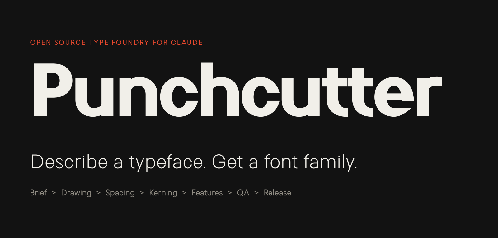
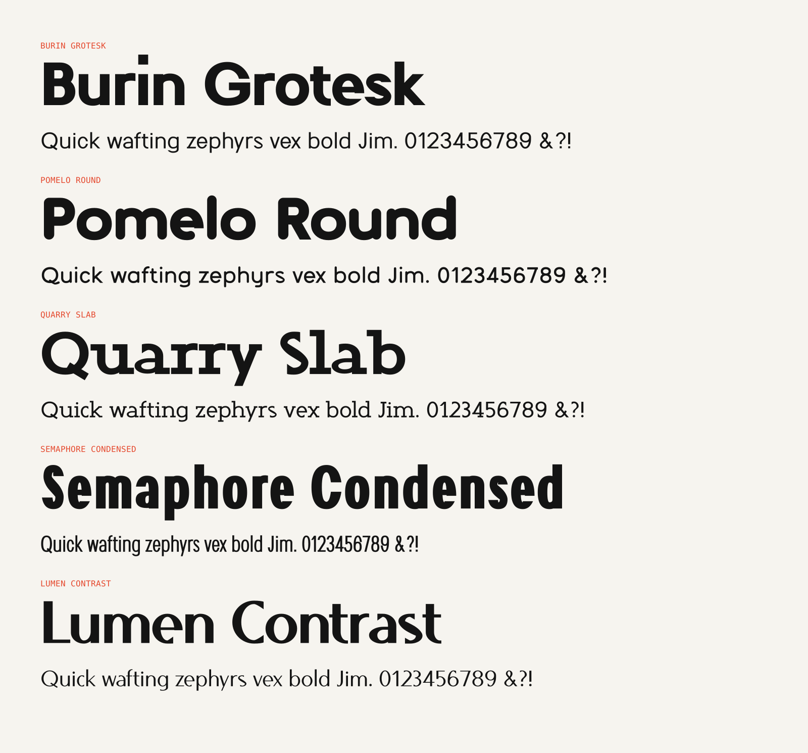
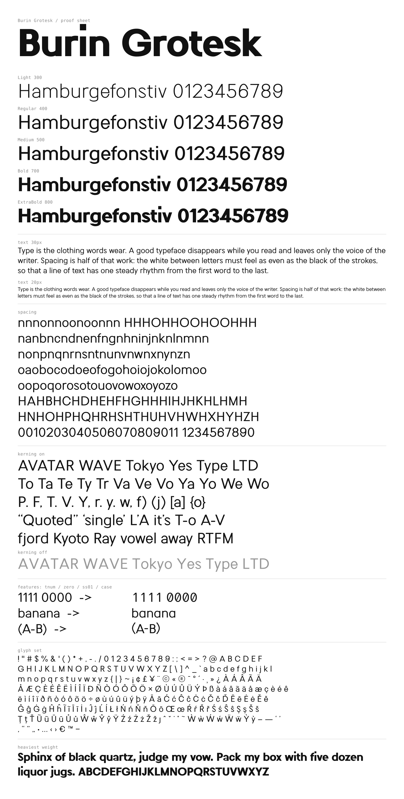
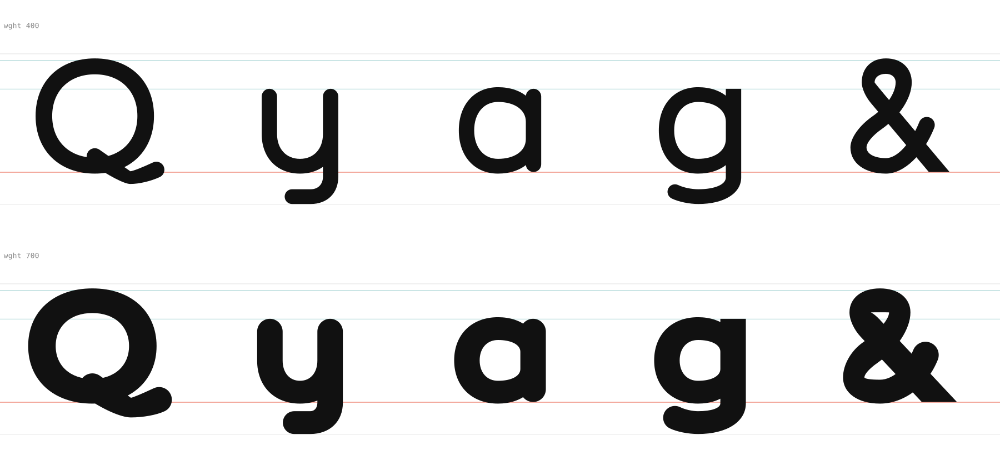

<p align="center"></p>

# Punchcutter

**A type foundry that runs inside Claude.** Describe the typeface you want in one sentence. Punchcutter designs it, spaces it, kerns it, tests it and hands you a real font family: variable font, desktop fonts, web fonts, specimen page.

The banner above is set in Burin Grotesk, a family Punchcutter built. So is everything in this gallery:

<p align="center"></p>

No photo of handwriting needed, no tracing, no font editor. The letters are drawn from scratch by a parametric engine, so every font is original and yours.

## What you get

```
> make me a font for my coffee brand. warm, round, a bit playful. call it Pomelo.
```

A few minutes later, after Claude has drawn it, looked at the proof and revised it:

- `Pomelo[wght].ttf` variable font with a weight axis
- Static TTF and OTF for every weight
- WOFF2 web fonts and ready `@font-face` CSS
- About 300 glyphs: Latin with accents for most European languages, figures, punctuation, currency
- Automatic spacing and class kerning (5,000 to 11,000 pairs)
- OpenType features: tabular figures, slashed zero, alternate a, case-sensitive punctuation
- A QA report, a proof sheet and an interactive specimen page
- UFO sources you can open in Glyphs, FontLab or RoboFont

## Install

**Claude Code**

```bash
npx skills add byrishi/punchcutter
pip install -r .claude/skills/punchcutter/scripts/requirements.txt
```

or copy `skills/punchcutter` into `~/.claude/skills/`.

**Claude app (web, desktop, mobile)**: download `punchcutter.skill` from Releases and add it under Settings, Skills.

Then just ask for a font.

## How it works

Punchcutter runs the same stages a type foundry does, and shows each one:

```
[1/9] Brief               Burin Grotesk: preset grotesque, 5 weights, 3 masters
[2/9] Drawing             301 glyphs per master (138 accented composites)
[3/9] Spacing             wght 400: stem 84, n 584, o 576, H 713
[4/9] Kerning             150 left classes x 129 right classes, 9697 pairs
[5/9] OpenType features   kern, case, tnum, zero, ss01
[6/9] Sources             3 UFO masters + designspace
[7/9] Compile             variable TTF, static TTF and OTF, WOFF2
[8/9] Quality assurance   140 checks on 11 files: 140 pass, 0 warn, 0 fail
[9/9] Release package     specimen.html, CSS, README, report
```

| Stage | What happens |
| --- | --- |
| **Drawing** | Letters are built from strokes, like a pen. One pen model gives every glyph the same weight, contrast, joins and terminals. Curves get points at their extremes, the way a type designer draws. |
| **Spacing** | Sidebearings are computed from the white space around each shape, so straight, round and diagonal letters end up evenly spaced. |
| **Kerning** | Every pair is measured in 2D. Pairs with too much air (AV, To, LT) are pulled together, collisions are pushed apart, and glyphs that behave alike are merged into classes. |
| **Compile** | Masters are point-compatible by construction, so they interpolate into a variable font. Built with fontmake, the toolchain used for Google Fonts. |
| **QA** | Coverage, metrics, naming, kerning, features and variation tables are verified on every output file. A failed check fails the build. |
| **Critique** | Claude looks at the proof sheet, finds weak letters, changes the design and rebuilds. Several rounds before anything ships. |

<p align="center"></p>

## Make it yours

Three levels of control. Use only the first if you like.

**1. Say it.** "Tighter. More contrast. Make the bold heavier. Square dots."

**2. Tune it.** Thirty design parameters (x-height, contrast, aperture, roundness, terminals, serifs, width, spacing and more) on top of eight starting presets: `geometric`, `grotesque`, `humanist`, `rounded`, `slab`, `technical`, `condensed`, `contrast`. See [parameters](skills/punchcutter/references/parameters.md).

```json
{
  "family": "Pomelo Round",
  "preset": "rounded",
  "weights": [400, 700],
  "glyphs": "pomelo_glyphs.py",
  "design": { "stem": 96, "xh": 520, "roundness": 0.6, "aperture": 0.65 }
}
```

**3. Redraw it.** Any letter can be replaced with a custom drawing in a few lines. The engine keeps it consistent with the family in every weight. See [drawing](skills/punchcutter/references/drawing.md).

```python
@glyph("Q", 0x51, "uc")
def Q(g):
    L.O(g)                                   # the stock O
    w = g.Ow                                 # then a tail that swings out under it
    g.add(g.P().m(w * 0.5, g.cap * 0.14, -35).c(w * 0.8, -g.cap * 0.05, "E").c(w * 1.02, g.cap * 0.02, 25))
```

<p align="center"></p>

You can also hand Claude a reference image for mood, or a sketch of a few letters, and it will design an original family in that spirit.

## Use without Claude

The engine is a plain Python CLI.

```bash
pip install -r skills/punchcutter/scripts/requirements.txt
cd skills/punchcutter/scripts

python punchcutter.py presets
python punchcutter.py new "My Sans" --preset humanist --weights 300,400,700
python punchcutter.py build MySans.json --draft     # seconds: static fonts + proof
python punchcutter.py build MySans.json             # full release
python punchcutter.py glyph MySans.json a g R       # close-up of letters
```

The five example families are in [`examples/`](examples). Burin Grotesk is included prebuilt in [`examples/fonts/BurinGrotesk`](examples/fonts/BurinGrotesk); open its `specimen.html`.

## Where it fits

Tools like draw-your-font and font-from-image turn a photo of handwriting or lettering into a font. Punchcutter does a different job: it designs a new typeface family from a description, with weights, kerning and features. Use those when you want your own handwriting; use this when you want a typeface.

## Honest limits

- Latin only for now (Basic Latin, Latin-1, Latin Extended-A accents).
- Upright styles. `slant` gives an oblique, not a true italic.
- Sans and slab designs. No bracketed serifs, scripts or blackletter yet.
- Unhinted outlines: sharp on macOS, iOS, Android and modern Windows; softer at very small sizes on old Windows.
- The output is a solid, usable family. A retail type designer would still refine individual curves and kerning pairs by eye. The UFO sources are there for exactly that.
- Make original fonts. Punchcutter is not for cloning commercial typefaces.

## Roadmap

True italics, bracketed serifs, monospace, Cyrillic and Greek, Devanagari and Gujarati, more stylistic sets, autohinting.

## Development

```bash
python tests/test_build.py
```

The tests draw every preset at three weights and confirm the masters are point-compatible, then build a family end to end and run QA.

## License

Code: MIT. Fonts you make are yours, under whatever license you choose. The example families are released under the SIL Open Font License 1.1.
